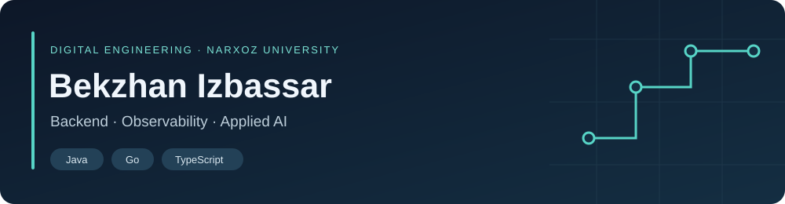

  

I'm a **Digital Engineering student at Narxoz University**, building projects with **Java, Go, and TypeScript**. My interests connect backend development with the systems around it: deployment, monitoring, and reliability. I also explore local AI tools.

> **Seeking a spring 2027 internship** in backend development, DevOps/SRE, cloud infrastructure, or applied AI. Expected start: **February 2027**, for approximately **two months**.

## Selected projects

### [Observability Lab](https://github.com/Bekzhanizb/alertsgrafana)
A Spring Boot demo for practicing service monitoring and incident diagnosis. Includes a Docker Compose stack, a provisioned Grafana dashboard, Prometheus alert rules, and a runbook.

**Java · Spring Boot · Docker Compose · Prometheus · Grafana · Alertmanager**

[Explore the project](https://github.com/Bekzhanizb/alertsgrafana) · [Alert rules](https://github.com/Bekzhanizb/alertsgrafana/blob/main/monitoring/prometheus/alerts.yml) · [Runbook](https://github.com/Bekzhanizb/alertsgrafana/blob/main/runbook.md)

### [Task Manager Backend](https://github.com/Bekzhanizb/TaskManagerBackend)
A Go learning project for task management, with HTTP handlers, PostgreSQL persistence, and repository implementations using GORM and SQL.

**Go · Gorilla Mux · GORM · PostgreSQL**

### [HR Management System](https://github.com/Bekzhanizb/HR-Management-System)
A Java coursework project for practicing backend development with Spring Boot, Spring Data JPA, and PostgreSQL.

**Java 17 · Spring Boot · Spring Data JPA · PostgreSQL**

### [AgentNest](https://github.com/Bekzhanizb/AgentNest)
A pre-alpha desktop project with an experimental local notes agent. It requests folder access, uses Ollama to summarize notes, and links results to their sources.

**TypeScript · React · Electron · Ollama · SQLite**

## Current focus

- **Backend:** developing APIs with Java and Go, and working with relational databases.
- **DevOps & SRE:** learning through containerized services, metrics, dashboards, alerts, and runbooks.
- **Cloud & infrastructure:** an area I want to develop further through an internship.
- **Applied AI:** experimenting with local models and source-linked workflows.

---

This profile highlights personal and university projects. Project repositories describe their implementation and current limitations.
